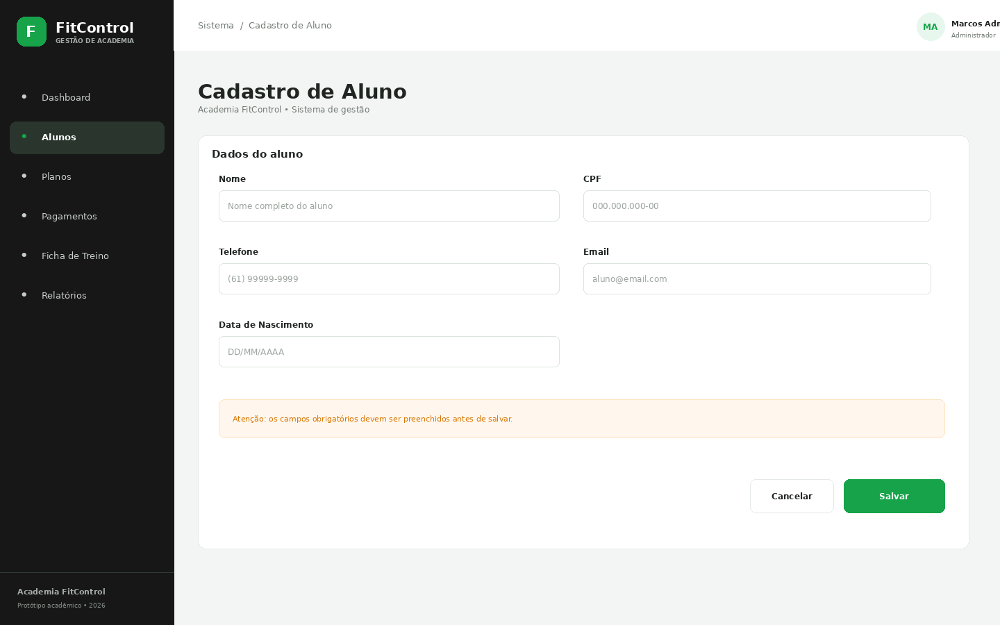

# 🏋️ FitControl


## Sistema de Gerenciamento de Academia


Projeto desenvolvido para a disciplina de Engenharia de Software com o objetivo de modelar e documentar uma solução para gerenciamento de academias.


---


## 👥 Integrantes


- Bruna
- José Victor Ferreira da Silva
- Luiz
- Marcos Neto


---


## 🎯 Objetivo


Desenvolver um sistema para gerenciamento de academias, permitindo o controle de:


- Alunos
- Planos
- Mensalidades
- Pagamentos
- Fichas de Treino
- Controle de Acesso por Catraca


---


## 🛠 Ferramentas Utilizadas


| Ferramenta | Finalidade |
|------------|------------|
| GitHub | Versionamento e documentação |
| Trello | Planejamento e gestão das tarefas |
| Draw.io | Modelagem UML |
| Figma | Prototipação das telas |


---


## 📂 Estrutura do Projeto


```text
FitControl
│
├── docs
│   ├── DRS.md
│   ├── HistoriasUsuario.md
│   └── Arquitetura.md
│
├── diagramas
│   ├── Diagrama de Casos de Uso
│   ├── Diagrama de Atividade
│   ├── Diagrama de Sequência
│   ├── Diagrama de Estado
│   └── Diagrama de Classe
│
└── wireframes
```


---


## 📑 Documentação


A documentação do projeto está organizada na pasta docs e contempla:


- Documento de Requisitos de Software (DRS)
- Histórias de Usuário
- Arquitetura do Sistema


---


## 📊 Diagramas UML


Os seguintes diagramas foram desenvolvidos:


- Diagrama de Casos de Uso
- Diagrama de Atividade
- Diagrama de Sequência
- Diagrama de Estado
- Diagrama de Classe


---


## 🏛 Arquitetura


O sistema foi modelado utilizando o padrão:


### MVC (Model-View-Controller)


- Model → Dados e entidades do sistema
- View → Interface com o usuário
- Controller → Regras de negócio


---


---
## 🎨 Wireframes

A seguir estão os protótipos de interface desenvolvidos para o sistema FitControl.

### 🔐 Tela de Login


### 👤 Cadastro de Aluno


### 📊 Dashboard


### 📋 Gerenciamento de Planos


### 💳 Controle de Pagamentos


### 🏋️ Ficha de Treino


